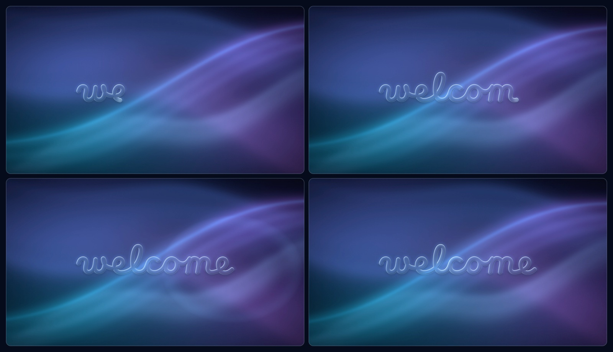

# Codex 启动动画

[](docs/MACOS.md)
[](macos/Package.swift)
[](media/MEDIA_NOTICE.md)
[](LICENSE)

适用于 macOS 的 **Codex / ChatGPT 桌面端 12 秒 4K 玻璃手写字 `welcome` 启动动画与原生 Swift 启动器**。支持从原 Codex 图标冷启动时自动触发、贴合窗口位置与连续圆角，并在结尾平滑叠化淡出交还控制权。

> **独立社区项目声明**：本项目与 OpenAI 无任何隶属或官方关联，不修改、不替换、不注入官方 Codex / ChatGPT 应用包。

<p align="center">
  
</p>

---

## 核心特性

- **12 秒 4K 透明玻璃手写字成片**：内置完整 3840 × 2160（30 fps、无声、8.19 MB）H.264 MP4 成片，开箱即用。
- **从 Dock 原图标冷启动自动触发**：通过轻量级 `LaunchAgent` 后台监视器监听应用冷启动，无需替换官方 App 或接管 Dock 图标。
- **窗口边界自动贴合与连续圆角**：读取系统提供的 Codex 主窗口几何边界，以 12 pt 连续圆角精确覆盖其上；直接双击启动器时则以全屏（或配置尺寸）独立运行。
- **智能收笔等待与平滑叠化交接**：
  - `6.2s` 处设有 `HoldAt` 驻留节点——若目标客户端尚未就绪，会在收笔波纹前优雅等待，直到主窗口可见后再继续播放；
  - `10.6s ~ 12.0s` 采用平滑曲线整体淡出覆盖窗，无缝揭示已就绪的 Codex 界面并交回键盘焦点。
- **随时跳过与低权限设计**：全程支持按下 `Esc` 或点击右上角「跳过 Esc」即时交接；默认不申请屏幕录制权限与辅助功能权限。
- **高度可配置**：通过 `launcher.json` 灵活调整播放视频、等待节点、淡出曲线、音量与目标应用（支持更换为任意本地 MP4 启动动画）。

---

## 12 秒动画分镜与时间轴

| 时间区间 | 阶段名称 | 画面与交互说明 | 对应配置参数 |
| :--- | :--- | :--- | :--- |
| `0.0s – 1.0s` | **光带亮起** | 深蓝渐变背景渐显，冰青与紫蓝双色光带开始流动 | — |
| `1.0s – 6.2s` | **手写连笔** | 小写 `welcome` 沿手写体字形一笔连写完成，半透明玻璃笔画透出背景光带 | `HoldAt = 6.2`（未就绪时在此驻留） |
| `6.2s – 8.0s` | **笔尖波纹** | 最后一笔收笔落定，从笔尖位置向外扩散一圈细微水波纹 | — |
| `8.0s – 10.6s` | **银蓝扫边** | 完整玻璃立体文字定格中央，银蓝色高光从左向右扫过字形边缘 | — |
| `10.6s – 12.0s` | **叠化淡出** | 背景光带收弱，启动器执行平滑透明度淡出，将焦点交还给底层 Codex | `TransitionStart = 10.6`<br>`TransitionEnd = 12.0` |

<p align="center">
  
</p>

---

## 快速开始

### 环境要求

- **操作系统**：macOS 13 (Ventura) 或更新版本（支持 Apple Silicon 与 Intel）
- **构建工具**：Xcode 或 Xcode Command Line Tools（Swift 5.9+，首次执行系统自带 `xcode-select --install` 即可）
- **目标客户端**：已安装 Codex / ChatGPT 桌面端（默认匹配 Bundle ID `com.openai.codex`）

### 1. 克隆仓库并一键构建安装

```zsh
git clone https://github.com/tiantutu798-bit/Codex-Startup-Animation.git
cd Codex-Startup-Animation
./scripts/install-codex-integration.sh
```

脚本会自动完成以下操作：
1. 使用本机 `swiftc` 编译原生 `DragonCodexBoot.app` 并完成本机 ad-hoc 签名；
2. 安装至 `~/Applications/DragonCodexBoot.app`；
3. 注册当前用户的登录启动监视器 `~/Library/LaunchAgents/community.dragoncodexboot.codex-watcher.plist` 并立即生效。

### 2. 体验冷启动动画

1. 若 Codex 当前正在运行，请先按 `⌘Q` 完全退出；
2. 像往常一样点击 Dock 栏或「应用程序」中的 **Codex** 图标；
3. 主窗口出现后即会自动贴合播放 12 秒 `welcome` 启动动画，第 `10.6s` 起平滑淡出并把控制权交还给 Codex（也可随时按 `Esc` 跳过）。

> **小提示**：你也可以直接双击打开 `~/Applications/DragonCodexBoot.app`（此时会以全屏置顶模式播放并启动 Codex）。

### 3. 一键卸载

如需停用监视器并移除启动器（个人配置与导入的视频会保留在 `~/Library/Application Support/DragonCodexBoot/` 中，官方 Codex App 不受任何影响）：

```zsh
./scripts/uninstall-codex-integration.sh
```

也可在 **系统设置 → 通用 → 登录项与扩展** 中随时关闭对应的后台项目。

---

## 配置与替换自定义动画

首次运行后，配置文件与默认视频会自动部署到用户支持目录：

```text
~/Library/Application Support/DragonCodexBoot/
├── launcher.json                      # 生效中的播放配置
└── media/
    └── welcome-glass-4k-12s.mp4       # 默认内置 12 秒 4K 成片
```

默认的 `launcher.json`（模板位于 [config/launcher.macos.example.json](config/launcher.macos.example.json)）内容如下：

```json
{
  "DisplayName": "Codex 启动动画",
  "Video": "media/welcome-glass-4k-12s.mp4",
  "AppBundleIdentifier": "com.openai.codex",
  "AppPath": "",
  "HoldAt": 6.2,
  "TransitionStart": 10.6,
  "TransitionEnd": 12.0,
  "MaxWaitSeconds": 60,
  "Volume": 1.0,
  "Fullscreen": true,
  "PlayerWidth": 1920,
  "PlayerHeight": 1080
}
```

### 更换为其他 MP4 视频

使用自带的导入脚本一键复制并校验新视频：

```zsh
./scripts/import-animation.sh /path/to/your-animation.mp4
```

随后按提示编辑 `~/Library/Application Support/DragonCodexBoot/launcher.json` 中的 `Video` 路径与 `HoldAt` / `TransitionStart` / `TransitionEnd` 时间点（需满足 `0 < HoldAt < TransitionStart < TransitionEnd`）。详细说明请参阅 [配置指南](docs/CONFIGURATION.md)。

---

## 项目结构

```text
Codex-Startup-Animation/
├── assets/
│   ├── hero-preview.jpg                         # 首页 4K 玻璃字成片预览图
│   └── storyboard-preview.jpg                   # 四阶段动画分镜预览图
├── config/
│   └── launcher.macos.example.json              # macOS 默认播放配置模板
├── docs/
│   ├── CONFIGURATION.md                         # launcher.json 全字段说明与时间轴校准
│   ├── MACOS.md                                 # 监听原理、圆角贴合与权限安全边界
│   └── TESTING.md                               # 自动化测试与桌面手动验收清单
├── macos/
│   ├── Package.swift                            # Swift Package 清单
│   ├── Sources/
│   │   ├── DragonCodexBootCore/
│   │   │   └── LauncherConfiguration.swift      # 配置编解码、校验与平滑淡出曲线
│   │   └── DragonCodexBootMac/
│   │       ├── DesktopFill.swift                # 可选铺满桌面可见区域辅助定位
│   │       └── main.swift                       # AppKit / AVKit 原生播放与 LaunchAgent 监视器
│   └── Tests/
│       └── DragonCodexBootCoreTests/
│           └── LauncherConfigurationTests.swift # 配置与淡出曲线单元测试
├── media/
│   ├── MEDIA_NOTICE.md                          # 12 秒成片规格、出处与媒体许可说明
│   └── welcome-glass-4k-12s.mp4                 # 12 秒 4K 玻璃手写字 welcome 动画
├── scripts/
│   ├── build-macos.sh                           # 编译并签名 build/DragonCodexBoot.app
│   ├── test-macos.sh                            # 编译、自检、签名与内嵌视频一致性校验
│   ├── import-animation.sh                      # 导入自定义 MP4 并备份配置
│   ├── install-codex-integration.sh             # 编译、安装至 ~/Applications 并注册 LaunchAgent
│   └── uninstall-codex-integration.sh           # 停止并清理 LaunchAgent 与启动器
├── .github/
│   ├── ISSUE_TEMPLATE/                          # Bug 反馈与功能建议模板
│   └── workflows/macos.yml                      # macOS GitHub Actions CI
├── CHANGELOG.md                                 # 版本更新日志
├── CONTRIBUTING.md                              # 贡献指南
├── LICENSE                                      # MIT 开源许可证
├── THIRD_PARTY_NOTICES.md                       # 第三方名称、框架与媒体声明
└── VERSION                                      # 版本号文件
```

---

## 开发构建与测试

无需修改系统环境，可在仓库根目录直接运行完整编译与自动化测试：

```zsh
# 运行 Swift Package 单元测试
swift test --package-path macos

# 构建 App 包并执行配置、淡出曲线、Plist、签名与媒体一致性检查
./scripts/test-macos.sh
```

更多测试项与实机验证步骤见 [测试指南](docs/TESTING.md)。

---

## 常见问题（FAQ）

<details>
<summary><b>1. 已打开的 Codex 切换窗口或最小化恢复时，为什么不会重新播放动画？</b></summary>

为了避免日常切换窗口被打断，后台监视器只在 **冷启动新进程**（即 `NSWorkspace.didLaunchApplicationNotification` 触发）时播放一次开屏动画。已运行状态下再次点击 Dock 图标不会重播。

</details>

<details>
<summary><b>2. 如果本机安装的是不同发行渠道或不同 Bundle ID 的客户端怎么办？</b></summary>

可通过以下命令查询实际应用标识：

```zsh
mdls -name kMDItemCFBundleIdentifier -raw /Applications/Codex.app
```

将结果填入 `~/Library/Application Support/DragonCodexBoot/launcher.json` 的 `AppBundleIdentifier`，或直接填写 `AppPath`（如 `"/Applications/ChatGPT.app"`）。

</details>

<details>
<summary><b>3. 为什么仓库默认不申请辅助功能（Accessibility）或屏幕录制权限？</b></summary>

启动器通过系统公开的 `CGWindowListCopyWindowInfo` 获取主窗口位置与大小并覆盖播放，完全不需要读取屏幕像素内容或注入窗口事件，从而最大程度保护隐私。仅当你主动在配置中启用实验性选项 `"FillDesktop": true` 时，才需要辅助功能权限来调整底层窗口尺寸。

</details>

---

## 开源许可与致谢

- **软件源码与文档**：基于 [MIT License](LICENSE) 开源；原生 macOS 启动器骨架演进自社区项目 **Dragon Codex Boot**。
- **随附动画视频**：[media/welcome-glass-4k-12s.mp4](media/welcome-glass-4k-12s.mp4) 规格与使用边界详见 [media/MEDIA_NOTICE.md](media/MEDIA_NOTICE.md)。
- **第三方声明**：OpenAI、Codex、ChatGPT、macOS 与 Apple 等名称与商标归各自权利人所有，详见 [THIRD_PARTY_NOTICES.md](THIRD_PARTY_NOTICES.md)。
